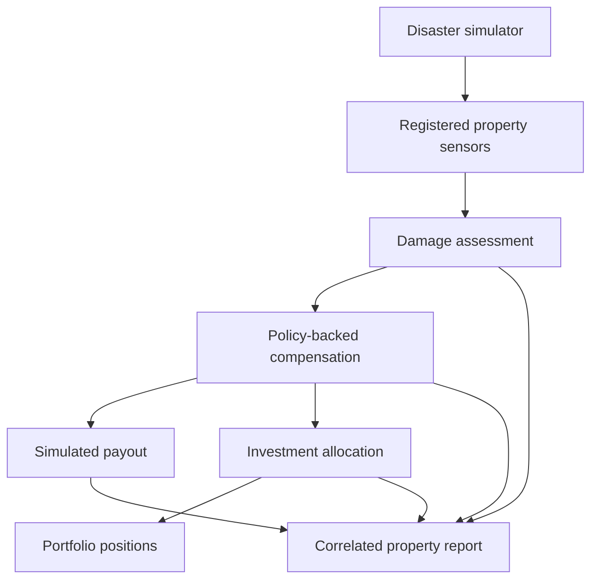

# Application event flow

Every event arrow below represents Kafka delivery; HTTP policy/owner lookups are described in ARCHITECTURE.md.

The control room triggers disasters through the BFF. The BFF also aggregates property/policy/user APIs and the reporting read model. PostgreSQL stores financial records, MongoDB stores damage; policies, users and reports are currently in memory. No Redis or blockchain component is implemented yet.
