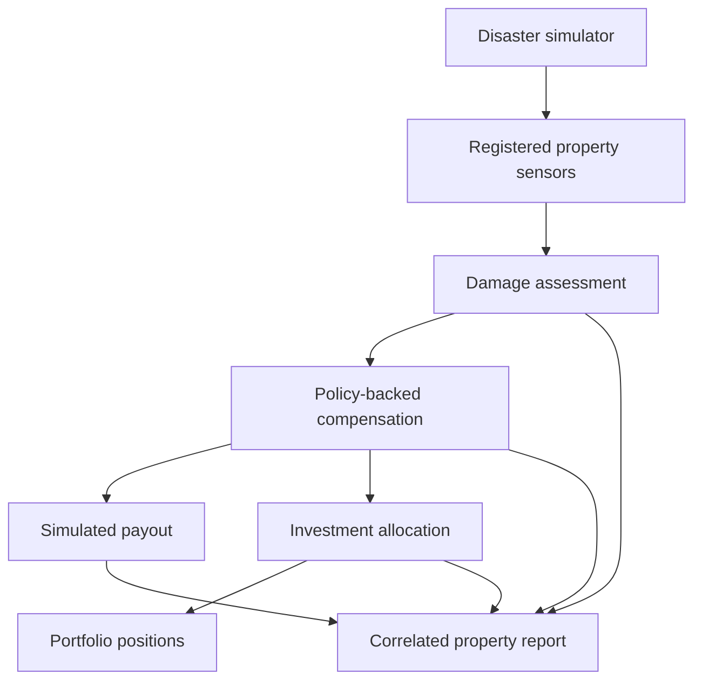

# Application event flow

Every event arrow below represents Kafka delivery; HTTP policy/owner lookups are described in ARCHITECTURE.md.

The control room triggers disasters through the BFF. The BFF also aggregates property/policy/user APIs and the reporting read model. PostgreSQL stores financial records, MongoDB stores damage; policies and users are in memory; reports default to memory and optionally use durable DynamoDB storage. No Redis or blockchain component is implemented yet.

## AWS export boundary

| Stage | Durable boundary |
| --- | --- |
| API Gateway → Export API Lambda | Cognito JWT plus property grant |
| Request → DynamoDB job/outbox | One transaction freezes the report |
| Outbox Streams → dispatcher → SQS | Repeated sends retain one stable jobId |
| SQS Lambda → Standard Step Functions | Stable execution name; partial batch failures |
| Generate → complete tasks | Deterministic S3 file followed by DynamoDB job completion |
| Authorized download request | Short-lived URL to a private S3 object |

This is a separate serverless branch; it does not replace financial Kafka delivery. See docs/aws/AWS_IMPLEMENTATION_RU.md.
