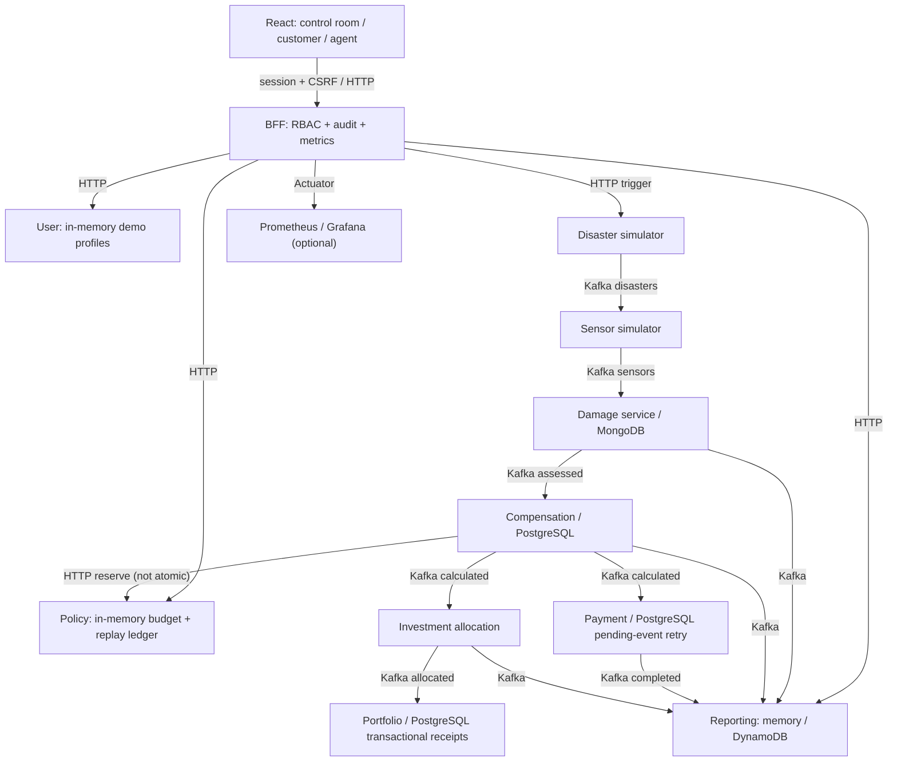

# Application event flow (2026-10-09)

Solid arrows are application flow; labels identify HTTP versus Kafka.

**Reliability boundaries:** portfolio decision receipt and positions commit in one
PostgreSQL transaction; the property-scoped advisory lock serializes writers.
Payment has a pending-event retry mechanism. Policy reservations remain in
memory, and compensation reserve HTTP + DB save are **not** atomic.
Reporting's optional AWS DynamoDB mode is distinct from the local memory mode.
Redis is optional for enrichment; there is no blockchain anchoring.

## AWS export boundary

| Stage | Durable boundary |
| --- | --- |
| API Gateway → Export API Lambda | Cognito JWT plus property grant |
| Request → DynamoDB job/outbox | One transaction freezes the report |
| Outbox Streams → dispatcher → SQS | Repeated sends retain one stable jobId |
| SQS Lambda → Standard Step Functions | Stable execution name; partial batch failures |
| Generate → complete tasks | Deterministic S3 file followed by DynamoDB job completion |
| Authorized download request | Short-lived URL to a private S3 object |

This is a separate serverless branch; it does not replace financial Kafka delivery. See docs/aws/AWS_IMPLEMENTATION_RU.md.
