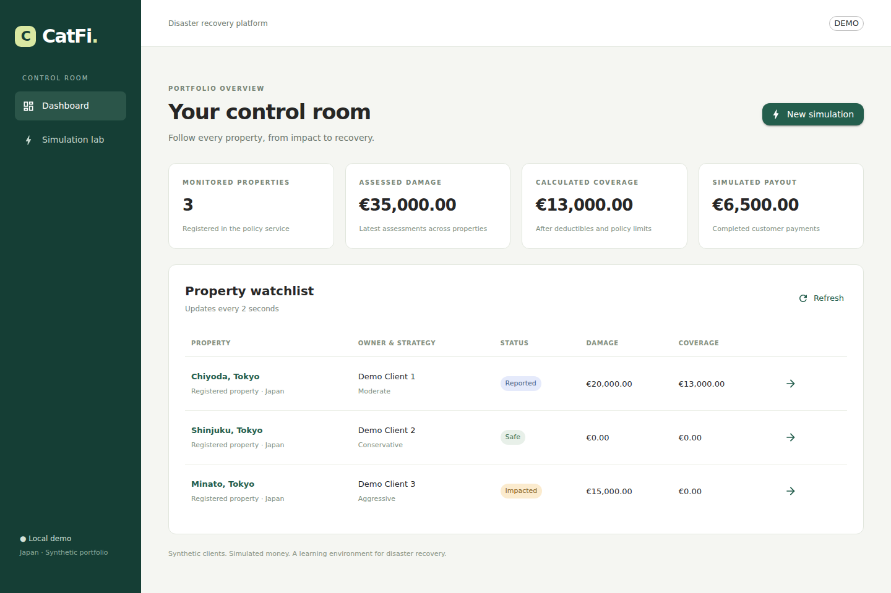

# CatFi · Control Room

An educational disaster recovery platform for Japan: synthetic properties and clients, simulated insurance compensation, payouts and investment allocations. The control room makes the asynchronous pipeline visible and lets you trigger a disaster manually.

**Current state:** all 17 Maven reactor projects build; the BFF, React UI and Kafka demo flow are implemented. Current verification results and runtime limits are in [VALIDATION.md](VALIDATION.md). Last updated: 2026-10-05.

## Product experience

- **Dashboard:** every registered property, owner, risk profile, active policy and latest report. Properties without a report remain visible as `SAFE`.
- **Simulation lab:** validated disaster type, intensity and coordinates. Success means Kafka acknowledged publication; subsequent processing is asynchronous.
- **Property details:** policy terms, damage, compensation, payout and asset allocations. ECharts displays the financial breakdown in EUR.
- **Reporting:** `IMPACTED` becomes `REPORTED` when the matching compensation and its required payout/investment events arrive. Events are correlated by assessment and compensation IDs, including out-of-order arrivals.



## Run the complete local demo

Requirements: Docker Desktop with Linux containers and Docker Compose. Run commands from the directory containing this README and `pom.xml`.

```powershell
Copy-Item .env.example .env
```

Set `CATFI_DB_PASSWORD` in `.env`, then:

```powershell
docker compose build catfi-bff web-ui
docker compose up -d --wait
```

Open **http://localhost:5173**. The demo profile seeds three Tokyo properties and matching clients. Trigger a simulation, return to the dashboard and open a property. Reports refresh every two seconds. Initial application startup may take longer than infrastructure health checks; the UI provides Retry.

Backend applications share the `catfi-backend:local` image built by `catfi-bff`. Only the UI and BFF publish HTTP ports; internal service endpoints are not published to the host. Infrastructure ports bind to loopback. This is a local demo, with no production BFF authentication.

Existing PostgreSQL volumes are preserved. Initialization scripts run only for a fresh volume. If an older volume predates the three demo databases, create the missing databases in PostgreSQL; do not delete an existing volume to repair configuration. See [DEVELOPMENT.md](DEVELOPMENT.md).

Weather and market services are optional:

```powershell
docker compose --profile enrichment up -d
```

Set `WEATHER_API_KEY` before calling the weather provider. Market prices and shocks are currently simulated.

## Development and checks

Java 21 and Maven Wrapper 3.9.11; Node.js 24 for frontend development.

```powershell
.\mvnw.cmd clean verify
.\mvnw.cmd verify -Pintegration
```

The first command runs 99 Java unit, web and component tests without Docker. The integration profile includes embedded Kafka tests and PostgreSQL Testcontainers, so the full profile requires Docker.

```powershell
cd web-ui
npm ci
npm test
npm run build
npx playwright install chromium
npm run test:e2e
npm run dev
```

Vite proxies `/api/ui` to the BFF on port 8087. Browser tests use deterministic API fixtures by default; a separate live test exercises the BFF and Kafka pipeline. Reproduction commands are in [VALIDATION.md](VALIDATION.md).

## Service inventory

| Module | Current responsibility |
| --- | --- |
| catfi-common | Shared immutable contracts and monetary terms; constructor metadata supports JSON reading without runtime Lombok |
| catfi-bff | OpenFeign aggregation, validated simulation proxy and CORS for local frontend origins |
| user-service | In-memory client profiles; demo clients |
| property-policy-service | In-memory properties and active policies; demo fixtures and property APIs |
| disaster-simulator | Manual REST event publication; scheduled simulation is opt-in |
| sensor-simulator | Observations for registered properties; preserves disaster IDs |
| damage-service | Simulated sensor damage calculation, MongoDB persistence and Kafka publication |
| compensation-service | Policy-backed calculation, compensation persistence, protected preview endpoint |
| payment-service | Simulated completed payout using `amountToPay` |
| investment-service | Owner risk lookup and asset allocation using `amountToInvest` |
| portfolio-service | Position quantities and accumulated weighted purchase prices |
| reporting-service | Correlated in-memory read model for current property reports |
| market-data-service | Simulated price snapshots |
| market-shock-service | Explicit disaster shock coefficients |
| weather-service | Metric OpenWeather mapping, bounded calls and sanitized provider errors |
| e2e-tests | Financial/HTTP contract tests and a Kafka pipeline integration test |

Blockchain anchoring, notifications, real market integrations, durable reporting, policy budget locking and inbox/outbox remain planned. The simulator currently applies observations to all registered properties; coordinates and intensity are retained but do not yet drive a geographic or physical model.

## Architecture and documentation

Services separate domain models, application logic, adapters and configuration. Constructor injection and targeted Lombok annotations reduce boilerplate; no runtime Lombok is required. Shared domain contracts remain independent of Spring, JPA, Kafka and HTTP. PostgreSQL handles financial records, MongoDB handles damage assessments; policies, users and reports currently use memory.

- [ARCHITECTURE.md](ARCHITECTURE.md): boundaries and current integration flow.
- [BUSINESS_RULES.md](BUSINESS_RULES.md): compensation, allocation and rounding.
- [SECURITY.md](SECURITY.md): actual protection and remaining work.
- [ROADMAP.md](ROADMAP.md): delivery stages.
- [VALIDATION.md](VALIDATION.md): executed checks and limitations.

This README is the living project overview. Update it in the same change whenever project behavior, services, setup or verification status changes. Keep history in CHANGELOG and decision rationale in DECISIONS. All project text remains English.

## Service responsibilities

Every module under `services/` has an English README describing its role, processing, communications and limitations. These pages are living documentation and must be updated alongside behavior changes. There is currently no separate security-service; security is implemented at application boundaries.
